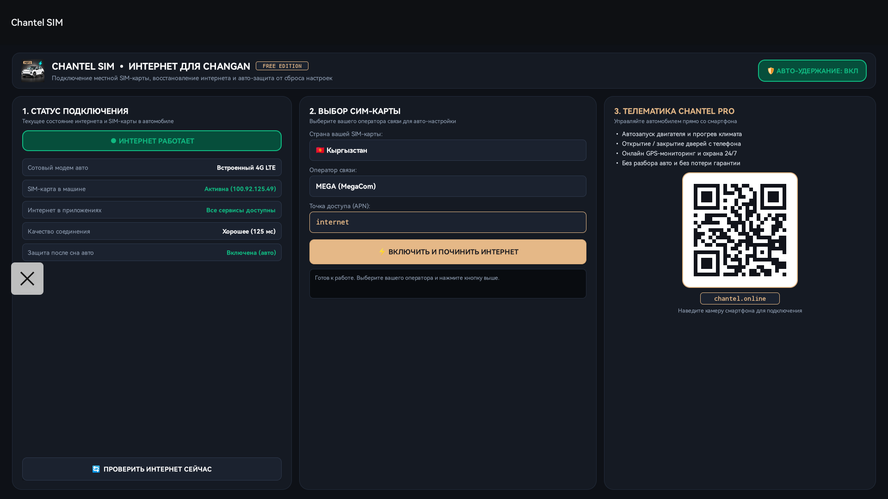

# 📱 Chantel SIM • Мобильный интернет для Changan

Бесплатная и простая программа для включения мобильного 4G интернета на автомобилях Changan (Qiyuan Q05 / A05 и др.) после установки местной SIM-карты.

---

## ✨ Возможности
* ⚡️ **Подключение в 1 клик:** выберите страну и вашего оператора связи — программа сама настроит правильную точку доступа (APN).
* 🛡 **Авто-защита связи:** интернет больше не будет слетать после стоянки или сна автомобиля.
* 🇰🇬 🇷🇺 🇰🇿 🇺🇿 **Поддержка операторов СНГ:** готовые профили для операторов Кыргызстана (MEGA, O!, Beeline), России (МТС, МегаФон, Билайн, Tele2, Т-Мобайл, СберМобайл, Yota), Казахстана, Узбекистана и Беларуси + возможность ввода своего APN.
* 🔓 **Работает без ROOT:** не требуется взлом прошивки или сторонние модификации.
* 🪶 **Компактная и быстрая:** размер приложения всего 600 КБ, мгновенный запуск на экране ГУ.

---

## 📥 Как установить

1. Скачайте готовый установочный файл: [**ChantelSIM_signed.apk**](ChantelSIM_signed.apk) *(или по прямой ссылке: [chantel.online/ota/ChantelSIM.apk](https://chantel.online/ota/ChantelSIM.apk))*.
2. Скопируйте APK на обычную USB-флешку.
3. Вставьте флешку в автомобиль и откройте штатный проводник / «Центр приложений».
4. Нажмите на файл **ChantelSIM** и подтвердите установку.
5. Запустите приложение с главного экрана, выберите вашего оператора и нажмите **«Включить и починить интернет»**.

---

## 🚘 О проекте
Разработано командой **[Chantel PRO](https://chantel.online)** — умная телематика для автомобилей Changan (климат-контроль и управление замками прямо со смартфона).
